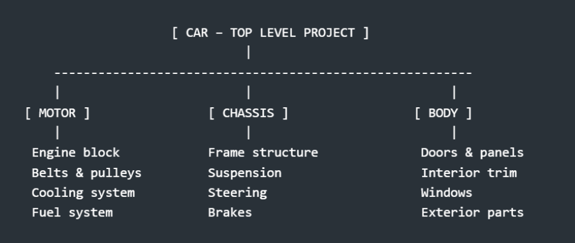

When working in **Cortona3D RapidAuthor**, one of the most important habits to develop early on is controlling how much geometry you import. Large CAD assemblies can contain thousands of parts, and loading everything at once can slow down your workflow, increase file sizes, and make authoring unnecessarily complex.

Instead of treating a massive product as one giant project, split it into multiple smaller RapidAuthor projects that can be reused across projects. Organize them based on:

- **Function** (e.g., electrical system, hydraulics)
- **Task** (e.g., replacing a filter, removing a panel)
- **Complexity** (e.g., assemblies with many moving parts)

This modular structure makes authoring more efficient and keeps each project lightweight.

## Bringing It all Together:

RapidAuthor works best when you bring in **only the geometry required for the task you’re documenting**. Importing only the relevant parts keeps your project:

- Import only what you need.
- Split large products into smaller projects.
- Use smart selection and camera control.
- Preview and refine before publishing.

By following these practices, you’ll create cleaner, more efficient, and more maintainable 3D documentation, regardless of product size or complexity. 

## References

- [Working with large assemblies](https://www.cortona3d.com/en/working-large-assemblies-best-practices)
- [Authoring and Basic Publishing in Cortona3D](https://www.youtube.com/watch?v=4Trdk2Kq4HE)
