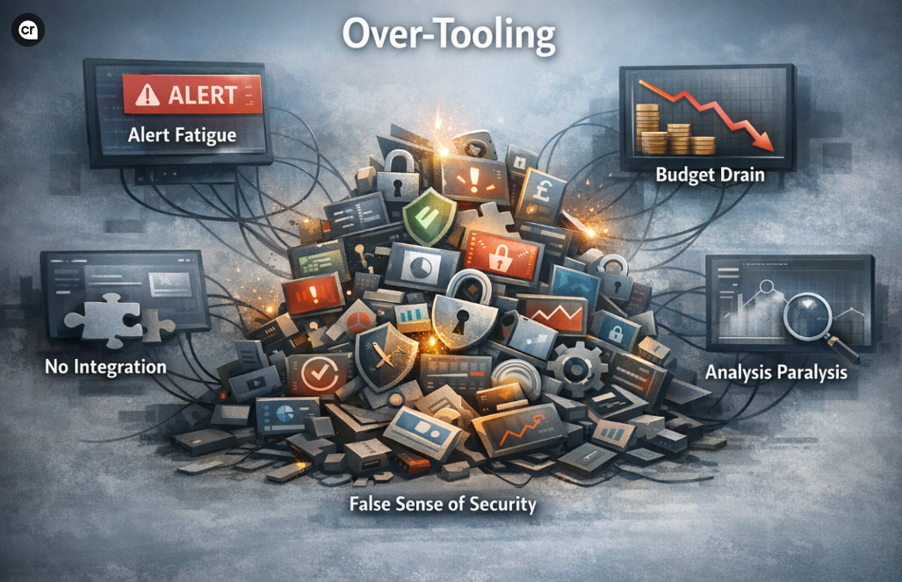

Attending the NEC cyber security show was a valuable opportunity to understand the current approaches to Cyber Security. The event provided insight into emerging trends, evolving threats, and how different organisations are responding. However, one theme did stand out in particular: the increasing speed at which modern breaches unfold. 

- Attackers can move laterally in under 30 minutes
- Most breaches are now credential-based
- Traditional controls (MFA, EDR) alone aren’t enough

👉 The real question is no longer “Do we have security tools?” It’s: **“If an attacker gets one click, how long until they reach something critical?”**

# In many cases, the challenge is not a lack of tools, but how effectively they are integrated and used to manage real-world risk.

## Common pitfalls include:

- Alert fatigue
- Poor integration
- Complexity and cost
- A false sense of protection

Tools only become valuable when they are:

- Integrated into **clear processes**
- Supporting a **defined risk or use case**
- Managed by **skilled teams**
- Delivering **actionable insights**, not noise

The goal should be to adopt a framework like cyber essentials then pick a tool to address problems such as 14-day requirement for high/critical updates.

## Why Identity Matters Most

- Over 80% of breaches involve passwords
- Modern attacks (AiTM) can bypass MFA by stealing session tokens
- Legitimate session access is now the attacker’s primary weapon.

## What Better Looks Like

Strong modern security focuses on:

- **Phishing-resistant authentication** (e.g. FIDO2)
- **Context-aware access** (device, location, risk)
- **Automated response** to stop attacks in seconds
- **Privileged access protection** (Tier 0 focus)
- **User resilience** through continuous training

## References

The content and insights in this post were informed by sessions delivered by the following organisations:

- Secarma – Too Many Tools, Not Enough Security
- Transition Technologies – From Passwords to FIDO2
- TechUK – Navigating the UK Cyber Policy Landscape
- Barracuda – Speed Matters: Automated Threat Response
- Stellar Cyber – Transforming SecOps with Agentic AI
- Cyber UK – Speed of Modern Breaches